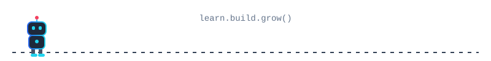

<!-- ═══════════════ ANIMATED HEADER ═══════════════ -->
<div align="center">


<a href="https://yomal-2004.github.io/">
  
</a>

<br/>


<br/><br/>

<a href="https://yomal-2004.github.io/">
  
</a>
<a href="https://yomal-2004.github.io/my_resume.pdf">
  
</a>
<a href="https://linkedin.com/in/yomal-daluwatta">
  
</a>

<br/><br/>

<!-- Robot #1: waving assistant (mirrors the AI assistant on the portfolio site) -->


</div>

<br/>

<!-- ═══════════════ ABOUT ═══════════════ -->
## 👨‍💻 About Me

<table>
<tr>
<td width="55%" valign="top">

I'm an aspiring Data Science undergraduate with a passion for building clean, efficient, and user-centric web applications. I focus on continuous learning and on solving real-world problems through robust code.

- 🎓 BSc (Hons) in Data Science at **Sri Lanka Technological Campus** (2025 – Present)
- 💼 Worked as a developer at **WEBCOMMS** (Oct 2024 – Nov 2025)
- 🧪 Worked on **250+ projects** at DP IT Campus Yatiyantota (Jan – Sep 2024)
- 📚 Studying Professional Practices, Object-Oriented System Architecture, and Database Management
- 🤝 Exploring internships, open-source collaboration, and technical research projects

</td>
<td width="45%" valign="top">

```python
class Yomal:
    role = "Data Science Undergraduate"
    campus = "Sri Lanka Technological Campus"
    languages = ["Python", "Java", "JavaScript"]
    focus = ["Web Dev", "Data Science", "ML", "BI"]
    open_to = ["Internships", "Open Source", "Research"]

    def motto(self):
        return "Learn. Build. Grow."
```

</td>
</tr>
</table>

<div align="center">

<!-- Robot #2: typing robot -->


</div>

<!-- ═══════════════ EDUCATION ═══════════════ -->
## 🎓 Education & Experience

| Period | Where | What |
|---|---|---|
| 2025 – Present | **Sri Lanka Technological Campus** | BSc (Hons) in Data Science |
| Oct 2024 – Nov 2025 | **WEBCOMMS** | Developer |
| Jan – Sep 2024 | **DP IT Campus Yatiyantota** | Worked on 250+ projects |
| Completed 2023 | Rajasinghe Central College, Ruwanwella | G.C.E. Advanced Level (Physical Science stream) |
| Completed 2020 | Rajasinghe Central College, Ruwanwella | G.C.E. Ordinary Level |

<!-- ═══════════════ TECH STACK ═══════════════ -->
## 🛠️ Tech Stack

<div align="center">
<a href="https://skillicons.dev">
  <picture>
    <source media="(prefers-color-scheme: dark)" srcset="https://skillicons.dev/icons?i=html,css,js,python,java,git,github,vscode,azure,wordpress&theme=dark&perline=10" />
    
  </picture>
</a>

<br/><br/>


</div>

<!-- ═══════════════ PROJECTS ═══════════════ -->
## 🚀 Featured Projects

<div align="center">
<a href="https://github.com/Yomal-2004/Student-Record-Management-System">
  
</a>
<a href="https://github.com/Yomal-2004/HospitalMS">
  
</a>
<a href="https://github.com/Yomal-2004/yomal-2004.github.io">
  
</a>
</div>

<div align="center">

<!-- Robot #3: data pipeline robot arm (ties to the Azure Data Pipeline project) -->


</div>

| Project | Category | Tech |
|---|---|---|
| 🎓 [Student Record Management System](https://github.com/Yomal-2004/Student-Record-Management-System) | Data management application focused on data integrity and user efficiency | `Python` `Tkinter` |
| 🏥 [Hospital Management System](https://github.com/Yomal-2004/HospitalMS) | Software project for hospital management | `Java` |
| 🌐 [Personal Portfolio](https://github.com/Yomal-2004/yomal-2004.github.io) | Website showcasing my profile, skills, projects, and certifications | `HTML` `CSS` `JavaScript` |
| 💼 [Portfolio Website](https://github.com/Yomal-2004/my_portfolio_website) | Additional portfolio website project | See repository |

<details>
<summary><b>More projects from my portfolio</b> 🔎</summary>

<br/>

| Project | Category | Tech |
|---|---|---|
| 📈 [Sales Forecasting Model](https://github.com/Yomal-2004/sales-forecasting-model) | Machine learning: monthly sales forecasting with clear error metrics | `Python` `scikit-learn` |
| 🧮 [Customer Churn Predictor](https://github.com/Yomal-2004/customer-churn-predictor) | Data science: flags customers likely to leave | `R` `Random Forest` |
| ☁️ [Azure Data Pipeline](https://github.com/Yomal-2004/azure-data-pipeline) | Data engineering: ETL that ingests, cleans and loads analysis-ready tables | `Azure` `SQL` `Python` |
| 💬 [Sentiment Analysis Dashboard](https://github.com/Yomal-2004/sentiment-analysis-dashboard) | NLP: scores customer reviews and summarises themes | `Python` `NLTK` |
| 🤖 [Portfolio Chatbot](https://github.com/Yomal-2004/portfolio-chatbot) | Web app: rule-based assistant for visitor questions | `HTML` `CSS` `JavaScript` |
| 📚 [Library Management System](https://github.com/Yomal-2004/library-management-system) | Java desktop app for books, members and loans | `Java` `SQL` |
| 🦠 [COVID-19 Data Explorer](https://github.com/Yomal-2004/covid-data-explorer) | Data visualisation: public health data with regional comparisons | `Python` `Matplotlib` |

</details>

<!-- ═══════════════ CERTIFICATIONS ═══════════════ -->
## 📜 Certifications

<details>
<summary><b>Click to expand all 9 certificates</b> ✨</summary>

<br/>

| Certificate | Link |
|---|---|
| 📊 Data Science - Work with Data | [PDF](https://yomal-2004.github.io/certificates/c1.pdf) |
| 📈 Data Science - Visualizing Data and Exploring Models | [PDF](https://yomal-2004.github.io/certificates/c2.pdf) |
| 📉 Data Science and Business Analytics | [PDF](https://yomal-2004.github.io/certificates/c3.pdf) |
| ☁️ Introduction to Microsoft Azure Data: Relational Data in Azure | [PDF](https://yomal-2004.github.io/Microsoft_Azure_certificate.pdf) |
| 🌐 Build a free website with WordPress | [PDF](https://yomal-2004.github.io/Coursera_certificate%2001.pdf) |
| 🎨 Graphic Design | [PDF](https://yomal-2004.github.io/Coursera_certificate%2002.pdf) |
| 📊 Getting Started in Google Analytics | [PDF](https://yomal-2004.github.io/Coursera_certificate%2003.pdf) |
| 📚 Become a Data Scientist: Statistics for Data Science | [PDF](https://yomal-2004.github.io/Simplilearn_certificate%2002.pdf) |
| 🗄️ Working with BigQuery | [PDF](https://yomal-2004.github.io/Coursera_certificate%2004.pdf) |

</details>

<!-- ═══════════════ GITHUB STATS ═══════════════ -->
## 📊 GitHub Analytics

<div align="center">


</div>

<!-- ═══════════════ CONTRIBUTION SNAKE ═══════════════ -->
## 🐍 Contribution Snake

<div align="center">
<picture>
  <source media="(prefers-color-scheme: dark)" srcset="https://raw.githubusercontent.com/Yomal-2004/Yomal-2004/output/github-snake-dark.svg" />
  <source media="(prefers-color-scheme: light)" srcset="https://raw.githubusercontent.com/Yomal-2004/Yomal-2004/output/github-snake.svg" />
  
</picture>
</div>

<!-- ═══════════════ CONNECT ═══════════════ -->
## 🤝 Let's Connect

I'm actively exploring internships, open-source collaboration, and technical research projects. Reach out through any of these:

<p align="center">
  <a href="https://yomal-2004.github.io/"></a>
  <a href="https://linkedin.com/in/yomal-daluwatta"></a>
  <a href="mailto:yomalcharu7@gmail.com"></a>
  <a href="https://www.youtube.com/@YomalDaluwatta"></a>
  <a href="https://www.tiktok.com/@yomaldaluwatta"></a>
  <a href="https://www.instagram.com/_cha_ru___/"></a>
  <a href="https://www.facebook.com/yomal.daluwatta"></a>
</p>

<div align="center">

<!-- Robot #4: walking robot divider -->


**Thanks for visiting my profile!** ⭐

*Learning today. Building for tomorrow.*


</div>
